# Example Supported Mermaid Diagrams

## Supported by the Add On

## Graph/Flowchart

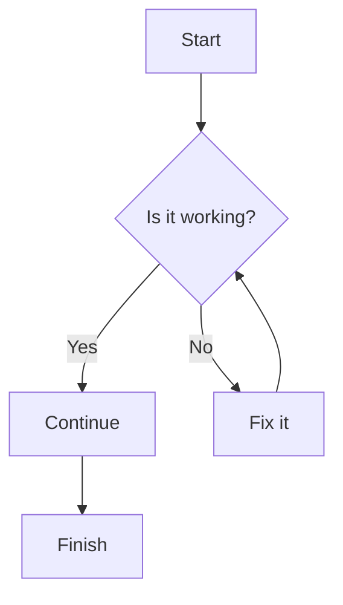

### Sequence Diagram

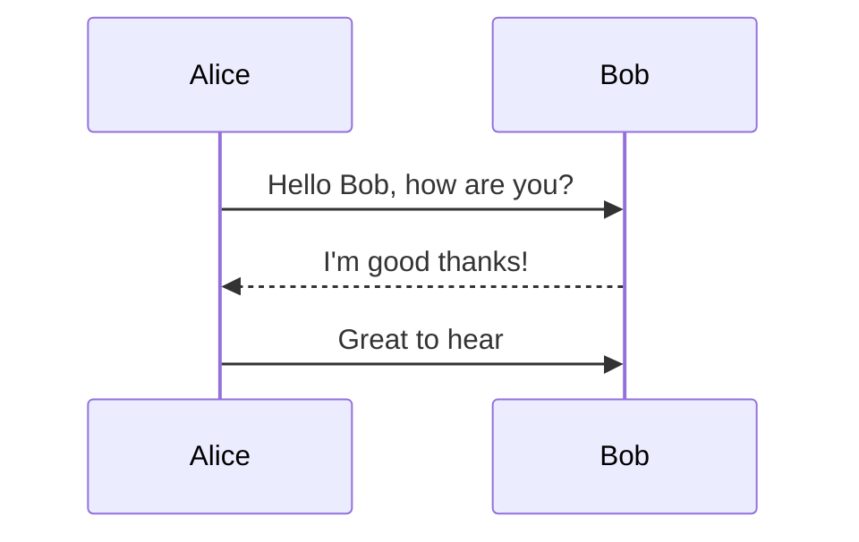

### Gantt

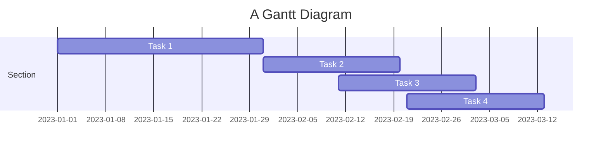

### Class Diagram

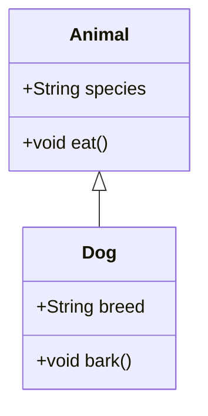

### State Diagram

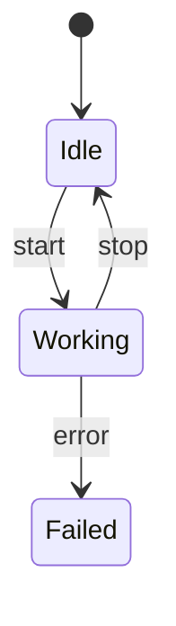

### Pie

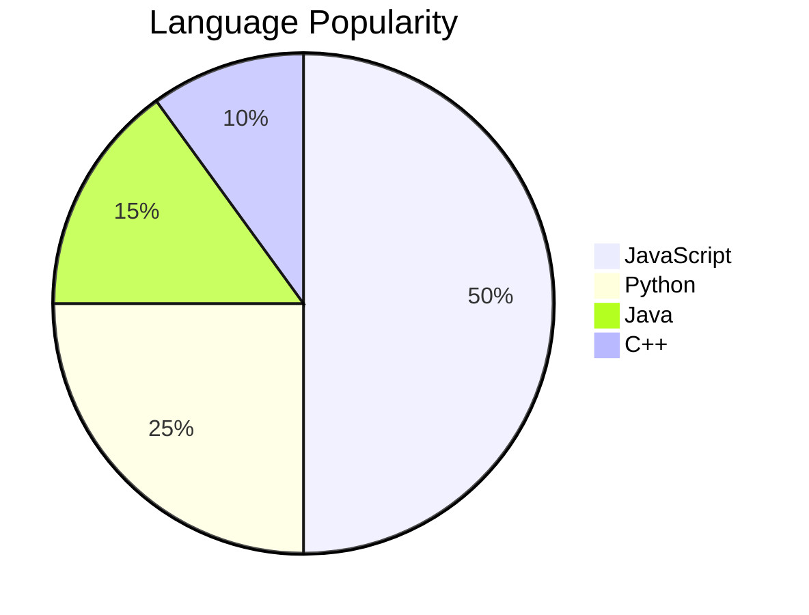

### erDiagram

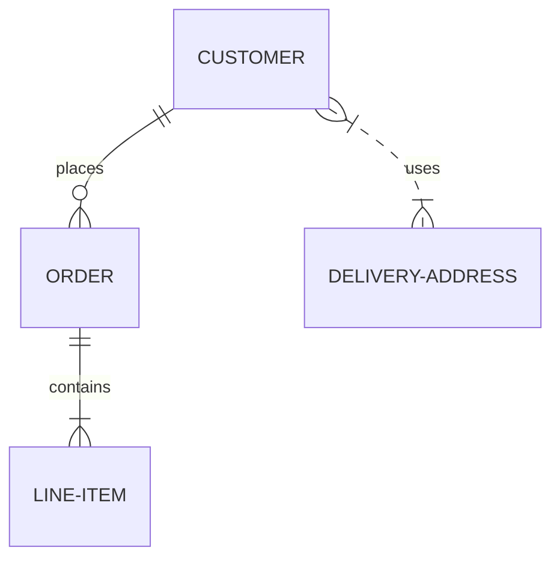

### Journey

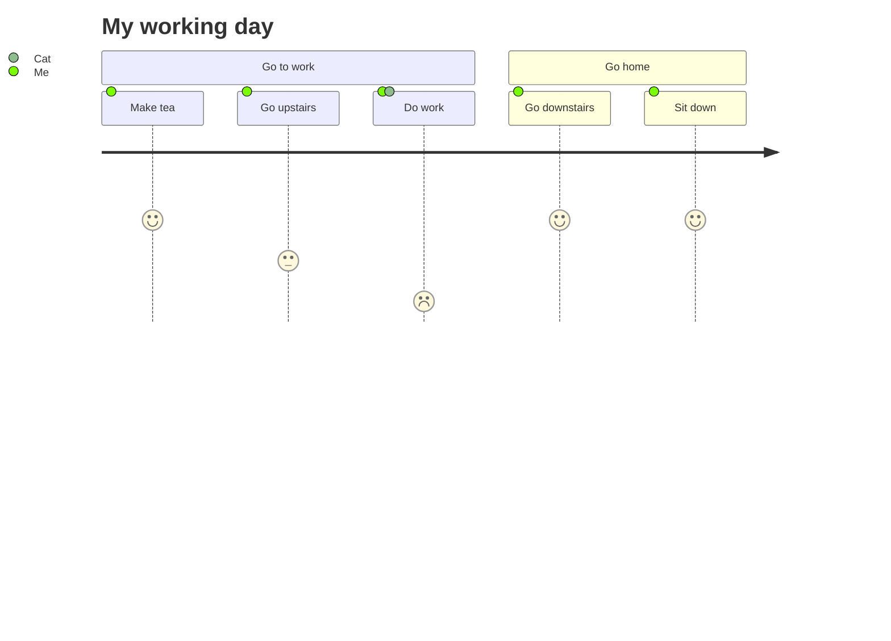

### Quadrant Chart

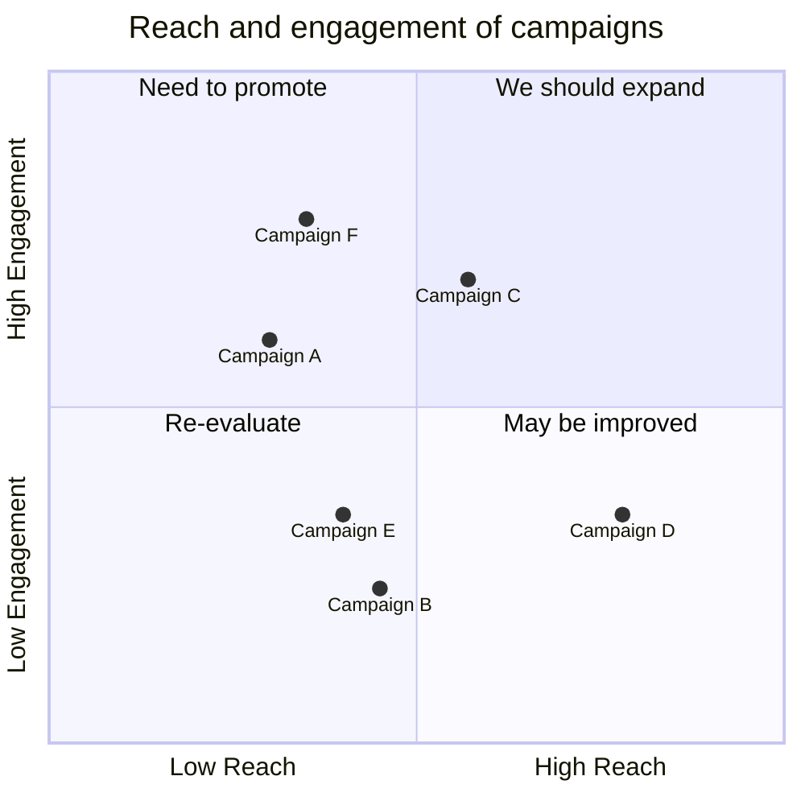

### Requirement Diagram

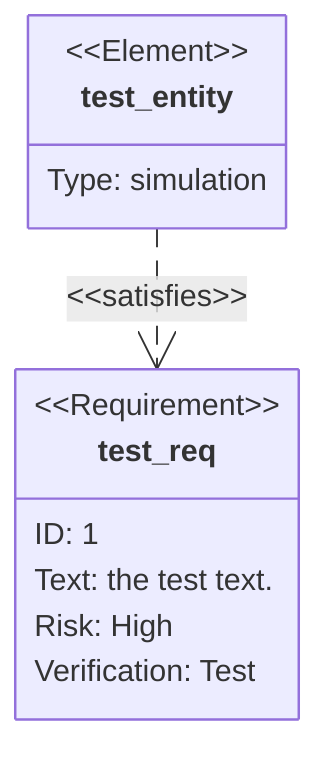

### GitGraph

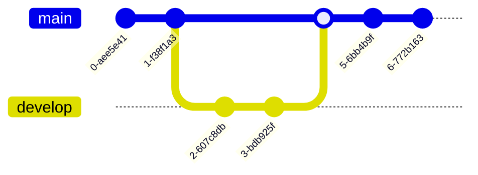

### MindMap

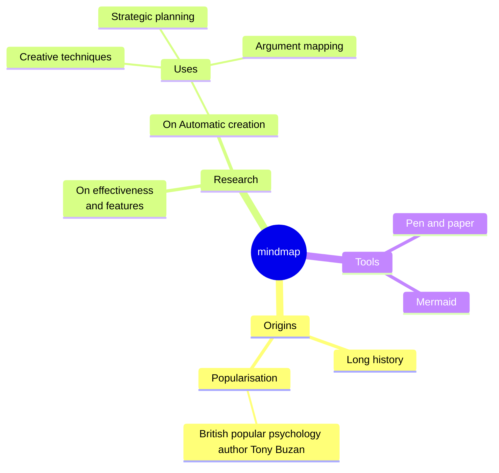

### Timeline

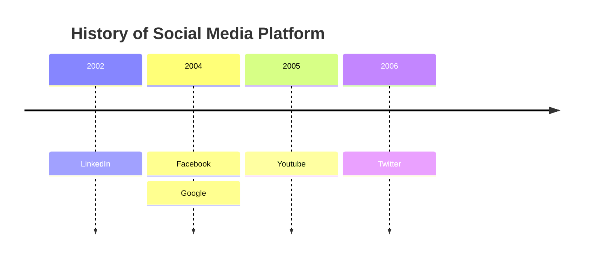

### XYChart-Beta

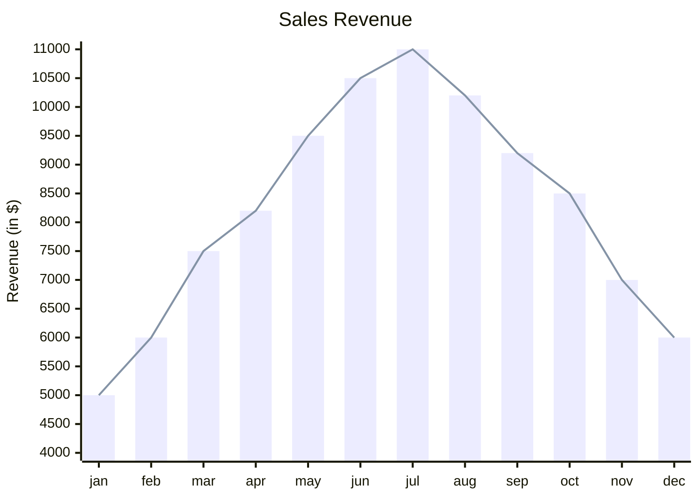

### Block Beta

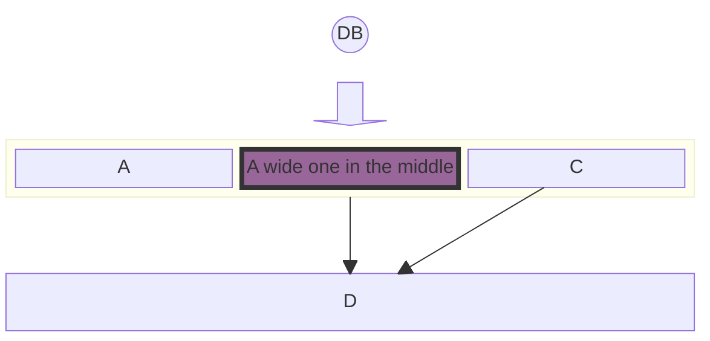

### Katex

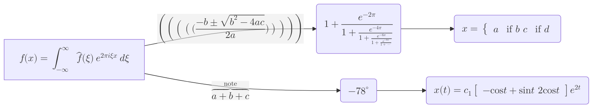

### Architecture Beta

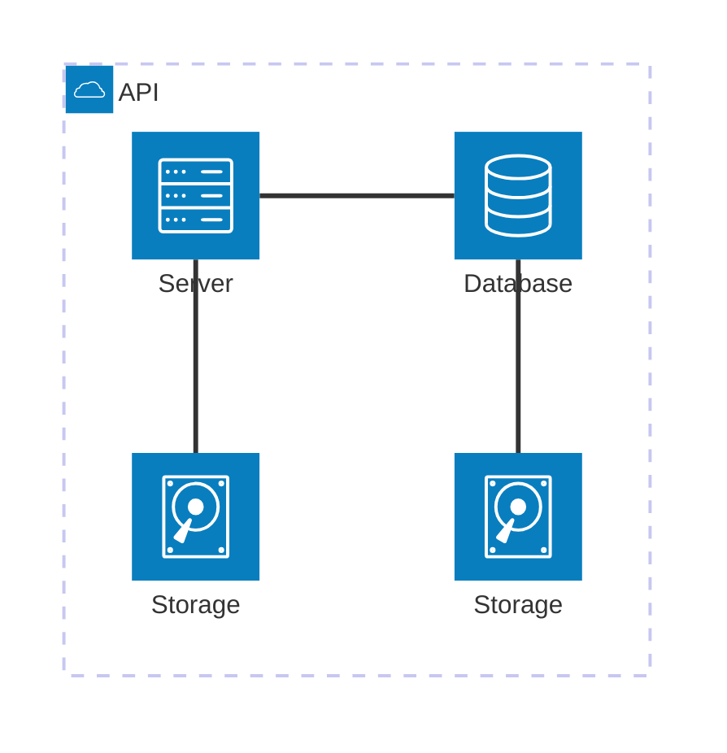

## C4 Diagram

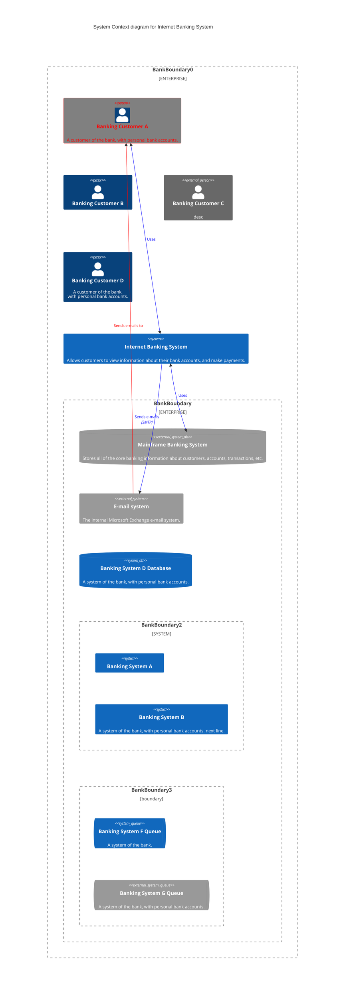

## ZenUml

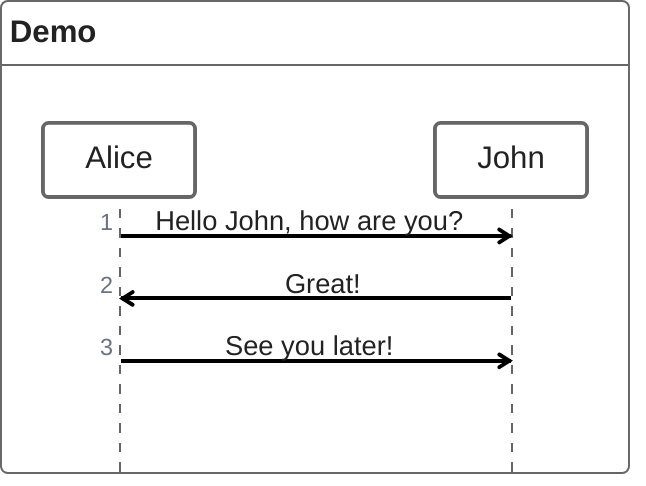
